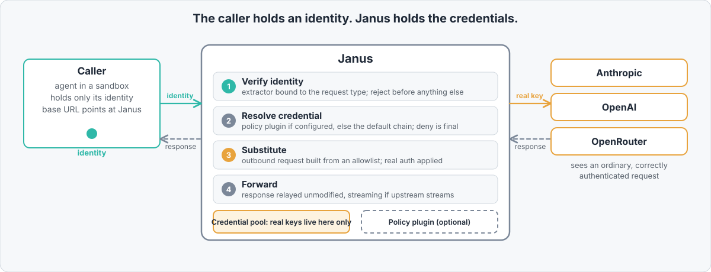
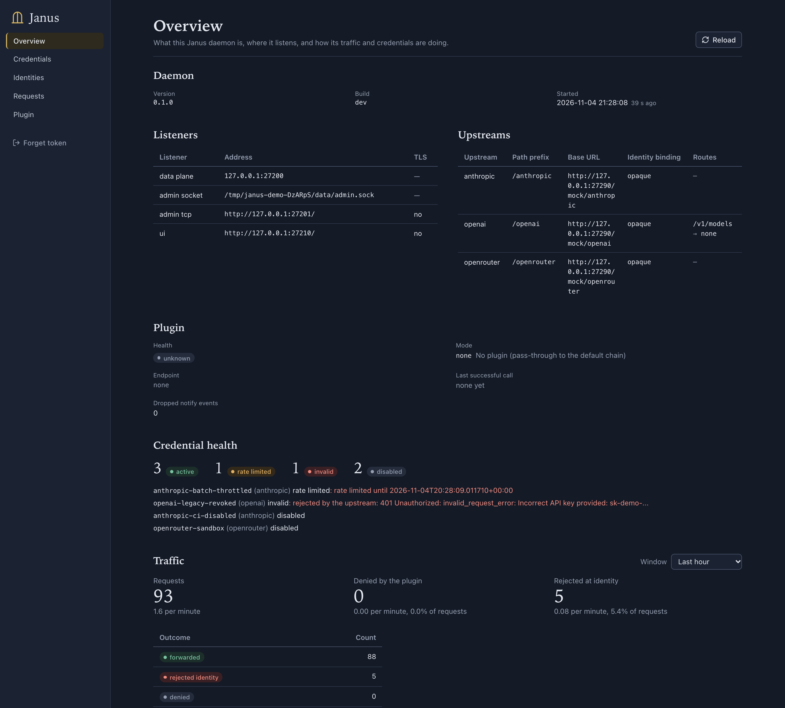
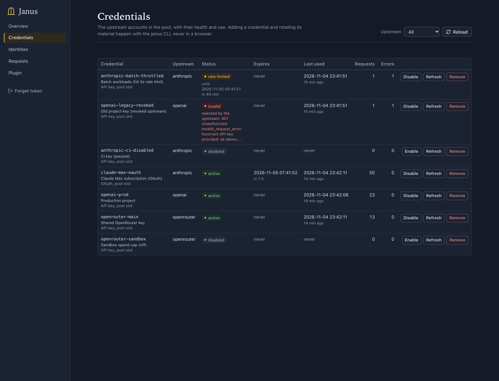
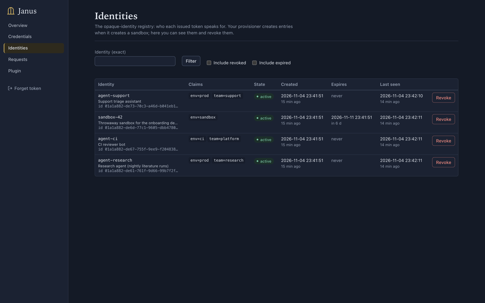
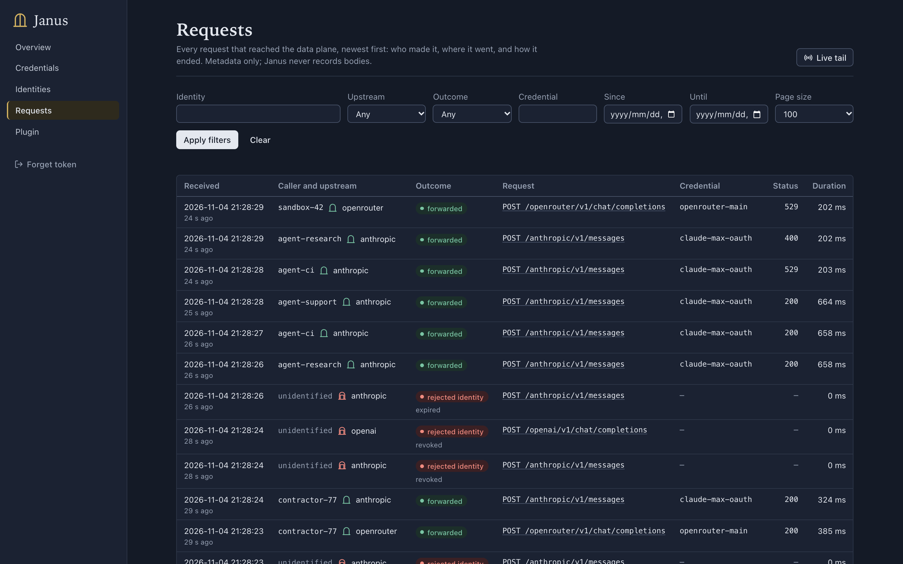
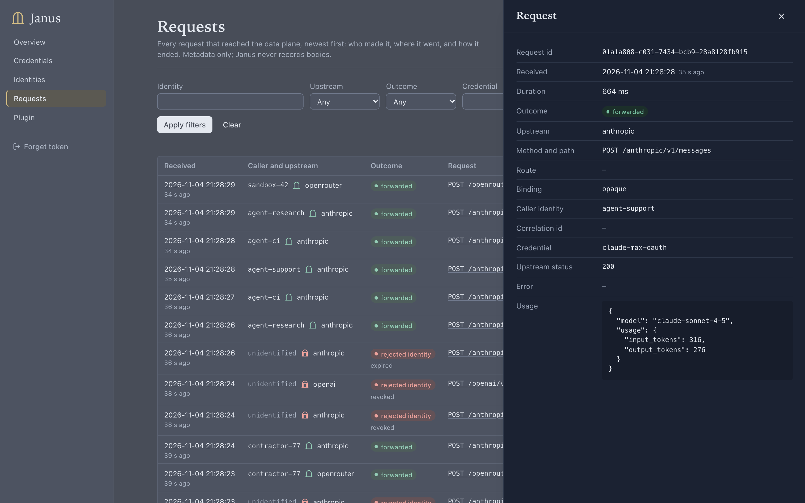
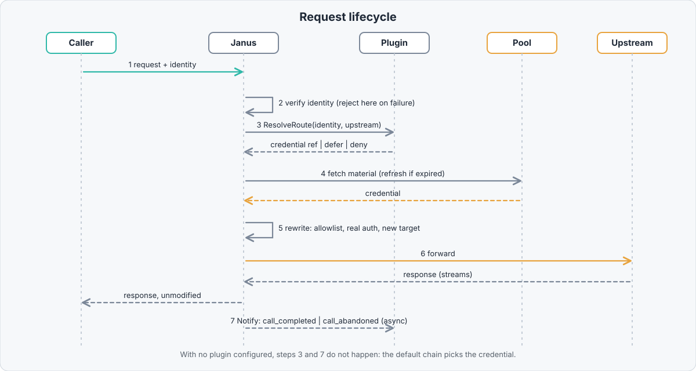
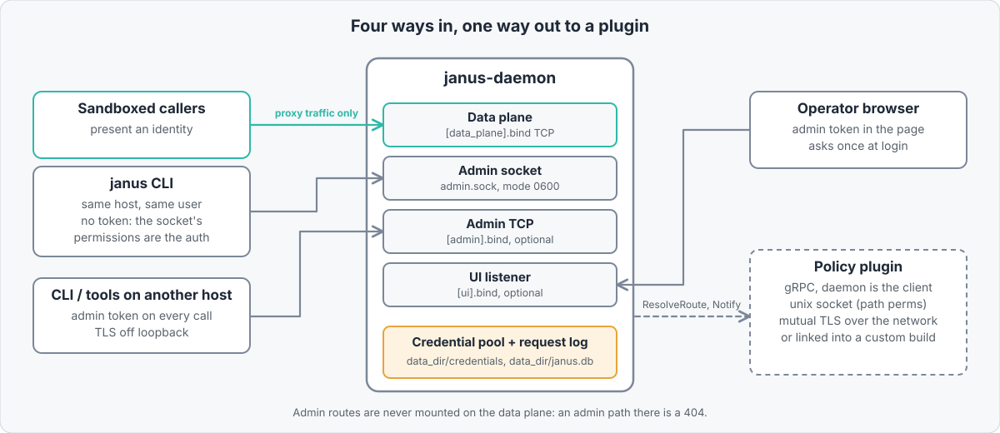

<p align="center">
  <picture>
    <source media="(prefers-color-scheme: dark)" srcset="docs/images/banner-dark.svg">
    
  </picture>
</p>

<p align="center">
  <a href="https://github.com/phantamorphism/janus/actions/workflows/ci.yml"></a>
  <a href="https://github.com/phantamorphism/janus/actions/workflows/docs.yml"></a>
  <a href="https://github.com/phantamorphism/janus/releases"></a>
  <a href="#license"></a>
</p>

**Janus is a proxy that sits between an agent and the authenticated APIs it
calls, so the agent presents an identity and Janus injects the real credential
on the way out. The agent can authenticate; it can never read the key it
authenticated with.**

## Why

- **Nothing worth stealing in the sandbox.** Agents hold a revocable identity,
  not a long-lived API key. A leaked identity is not the credential behind it.
- **Every call is attributable.** Each request is tied to the identity that made
  it, in a request log, instead of landing on one shared account.
- **Revocation is surgical.** Cut off one agent without rotating the key every
  other agent uses.
- **Policy at the chokepoint.** Every call crosses Janus, so authorization and
  budget checks run before anything reaches the upstream, through a plugin
  contract rather than forks.

## How it fits

<p align="center">
  
</p>

The caller uses the upstream's own API or SDK, changing only the base URL and
the credential it presents. Janus does not define an API of its own in front of
an upstream. See <ref target="docs/credential-substitution">credential
substitution and policy enforcement</ref>.

## See it

The operator UI is served by the daemon on its own port.

<table>
  <tr>
    <td width="50%"><br><sub>Overview: listeners, upstreams, credential health, plugin</sub></td>
    <td width="50%"><br><sub>Credentials: status and counters, never material</sub></td>
  </tr>
  <tr>
    <td width="50%"><br><sub>Identities: the registry, with revoke</sub></td>
    <td width="50%"><br><sub>Requests: filterable log with live tail</sub></td>
  </tr>
</table>

<p align="center">
  <br>
  <sub>One request: who called, which credential, what the outcome was</sub>
</p>

## Features

Built and running; see <ref target="docs/status">status</ref> for the
authoritative list.

- **Upstreams:** Anthropic, OpenAI (API keys and ChatGPT-account OAuth) and
  OpenRouter, relayed unmodified, streaming included. Claude Code and Codex CLI
  run through Janus on their subscription logins.
- **Several endpoints per vendor:** an `[[upstream]]` is an instance, so
  `/anthropic` (API keys only) and `/claude` (subscription only) are separate
  endpoints with separate budgets, each with its own credential filter.
- **Caller identity, verified locally:** `hmac`, `jwt` (JWKS or public key),
  `opaque` (a daemon-managed registry with expiry and instant revocation),
  `trusted_header`, and `none` for explicitly open routes. Bound per daemon, per
  upstream or per path.
- **Credential pool:** config credentials and pool slots added live; OAuth
  refresh; enable, disable, rotate; tags; a default chain when no plugin
  chooses, with a per-instance strategy (`ordered`, `round_robin`,
  `least_recently_used`, `sticky`) and optional failover to the next credential
  when the vendor rejects one.
- **Policy plugins:** `ResolveRoute` (sync, fails closed) and `Notify` (async)
  over a unix socket, mutual TLS, or linked into a custom build; metering
  primitives with in-memory and SQLite stores.
- **Admin surface:** one HTTP+JSON API on a `0600` unix socket by default, an
  opt-in token-guarded TCP listener, and a UI listener.
- **`janus` CLI:** status, credentials, identities, request-log query and tail,
  plugin check and TLS bootstrap, config check.
- **Request log:** metadata only (no bodies), SQLite, with retention.
- **Not built, on purpose:** response transformation, a replicated usage store,
  credential entry in the UI, body capture in the log. See
  <ref target="docs/status#open-questions">status</ref>.

Janus targets the three LLM APIs first, but the model applies to any
authenticated HTTP service.

## Quickstart

```sh
cargo build --release
export PATH="$PWD/target/release:$PATH"
export JANUS_DATA_DIR="$PWD/data"

cat > config.toml <<'EOF'
[data_plane]
bind = "127.0.0.1:7600"

[identity]
method = "opaque"
source = { header = "authorization", scheme = "Bearer " }

[[upstream]]
name        = "openrouter"
path_prefix = "/openrouter"
base_url    = "https://openrouter.ai/api"
EOF

janus-daemon --config config.toml &

printf '%s' "$OPENROUTER_API_KEY" \
  | janus credential add --upstream openrouter --api-key-stdin
TOKEN=$(janus identity create --identity agent-1 --expires-in 1h)

curl -s http://127.0.0.1:7600/openrouter/v1/models \
  -H "Authorization: Bearer $TOKEN"
```

The agent only ever holds `$TOKEN`. To serve the web UI, build `ui/` and place
it in a `ui` directory beside the executable (or set `ui.assets_dir`). The
<ref target="docs/quickstart">full walkthrough</ref> runs against a local
stand-in upstream you can inspect, and covers the log, revocation and the UI.

## Subscriptions, several accounts and Docker

An `[[upstream]]` is an *instance*: it has its own path prefix and a filter on
which credentials it may spend, so one vendor can be exposed as several
endpoints. A pool of several keys or accounts is spread by a strategy; anything
that depends on who is calling is the policy plugin's job.

```toml
[[upstream]]                       # API keys, spread, failing over on rejection
name = "anthropic"
path_prefix = "/anthropic"
base_url = "https://api.anthropic.com"
strategy = "round_robin"
failover = true
[upstream.credentials]
kind = "api_key"

[[upstream]]                       # Claude subscription logins, one per caller
name = "claude"
implementation = "anthropic"
path_prefix = "/claude"
base_url = "https://api.anthropic.com"
strategy = "sticky"
[upstream.credentials]
kind = "oauth"

[[upstream]]                       # Codex (ChatGPT) subscription logins
name = "codex"
implementation = "openai"
path_prefix = "/codex"
base_url = "https://api.openai.com"
strategy = "least_recently_used"
[upstream.credentials]
kind = "oauth"
```

Add a subscription login with
`janus credential add --upstream anthropic --from-file <credentials.json>`
(Claude Code) or `--upstream openai --from-file ~/.codex/auth.json` (Codex).
Janus refreshes its copy, so a refresh token may rotate: use a dedicated login
rather than the one your own CLI depends on. The caller still sends its own
client headers (Claude Code sends its system prompt), because Janus relays
requests unmodified.

```sh
# Claude Code on the subscription endpoint
ANTHROPIC_BASE_URL=http://127.0.0.1:7600/claude ANTHROPIC_AUTH_TOKEN=$TOKEN claude

# Codex CLI: base_url has no /v1; websockets are off because Janus relays HTTP
codex exec -c 'model_providers.janus={name="janus",base_url="http://127.0.0.1:7600/codex",env_key="JANUS_TOKEN",wire_api="responses",supports_websockets=false}' \
           -c model_provider=janus "..."   # with JANUS_TOKEN=$TOKEN
```

To run the daemon in a container with a persistent volume, mount your config and
a volume at `/var/lib/janus`, and publish the ports to loopback:

```sh
docker run -d --name janus --restart unless-stopped \
  -p 127.0.0.1:7600:7600 -p 127.0.0.1:7601:7601 \
  -v janus-data:/var/lib/janus -v "$PWD/janus.toml:/etc/janus/janus.toml:ro" \
  janus:local        # built with: docker build -t janus:local .
docker exec -i janus janus credential add --upstream openrouter --api-key-stdin
docker exec janus janus identity create --identity agent-1 --expires-in 24h
```

Inside the container the UI binds `0.0.0.0`, which Janus refuses in plaintext
unless `allow_plaintext = true` is set in `[ui]`; that is safe only while the
port is published to loopback. The reference is
<ref target="docs/configuration#upstreams">upstreams and credential
filters</ref>; the reasoning is in
<ref target="docs/decisions#upstream-instances">upstream instances</ref>.

## How it works

<p align="center">
  
</p>

Janus verifies the caller's identity first and rejects before touching anything
else if it does not verify. The credential is then resolved by a plugin or the
default chain, fetched from the pool, and the outbound request is built from a
per-upstream allowlist, so the caller's identity material is absent from it
rather than deleted. Janus verifies identities; it does not mint them. Details:
<ref target="docs/architecture">architecture</ref> and
<ref target="docs/caller-identity">caller identity extraction</ref>.

## Plugin contract

Policy is reached through one contract, `proto/janus.proto`. Janus is always the
client.

- **`ResolveRoute`** is synchronous: given a verified identity and the upstream,
  a plugin answers with a credential, a deferral to the default chain, or a
  denial. It fails closed: an unreachable or erroring plugin rejects the
  request.
- **`Notify`** is a fire-and-forget event stream with one generic envelope.

With no plugin configured Janus makes no plugin calls and is a plain
credential-substituting proxy. See <ref target="docs/plugin-contract">the plugin
contract</ref>.

## Configuration, admin and CLI

<p align="center">
  
</p>

- <ref target="docs/configuration">Daemon configuration</ref>: every section and
  key of the config file. Unknown or ineffective keys refuse startup.
- <ref target="docs/admin-surface">Admin surface, CLI and UI</ref>: endpoints,
  the `janus` command set, exit codes, the request log.
- Admin routes are never mounted on the data plane, so a caller cannot address
  them. `janus --help` lists every command.

## Security model

Janus is built to defend against:

- **Credential theft from the sandbox.** The agent, any dependency it runs, and
  any prompt-injected instruction can read only an identity, not the credential.
- **Cross-caller blast radius.** Identities are separately attributable and
  revocable; a plugin can scope which credential each one may use.
- **Reaching credential management from the data plane.** Admin runs on separate
  listeners; every TCP admin listener requires a token, and non-loopback binds
  require TLS or an explicit opt-out.
- **A fail-open policy.** A plugin that cannot be reached denies; it never
  silently falls back to a default credential.

It does not defend against:

- **Misuse through Janus.** A caller holding a valid identity can still spend
  the credential Janus applies on its behalf, within whatever policy you
  configure. With no plugin and the default chain, that is every active
  credential for that upstream.
- **Open and header-trusted routes.** A `method = "none"` route is open to
  anything that can reach the data plane, and `trusted_header` is only safe
  behind a front proxy that authenticates callers.
- **A compromised Janus host or operator account.** The daemon holds the
  credentials; anyone running as its user can read the data directory.
- **Upstream content.** Responses are relayed unmodified.

Report vulnerabilities privately; see [SECURITY.md](SECURITY.md).

## Project status

Janus is pre-1.0. The daemon, core library, CLI and UI are implemented; what is
deliberately not built, and what would trigger building it, is in
<ref target="docs/status">status</ref> and <ref target="docs/decisions">decision
records</ref>. Scope boundaries are in <ref target="docs/scope">scope and
non-goals</ref>.

## Documentation

Design docs live in `docs/`, start at
<ref target="docs/index">docs/index.md</ref>. This repo is a
[Schematic](https://github.com/phantamorphism/schematic) corpus
(`schematic.yaml` at the root), kept consistent by the `sch` CLI; edit docs with
the `sch branch` / `sch check` / `sch fix` / `sch commit` / `sch merge` loop
rather than plain git. The workspace is `crates/janus-core`,
`crates/janus-daemon` and `crates/janus-cli`, plus `proto/` and the web UI in
`ui/`.

## Contributing

Contributions are welcome; see [CONTRIBUTING.md](CONTRIBUTING.md) and the [Code
of Conduct](CODE_OF_CONDUCT.md). Design changes start in the docs.

## License

Dual-licensed under [MIT](LICENSE-MIT) or [Apache 2.0](LICENSE-APACHE), at your
option.
